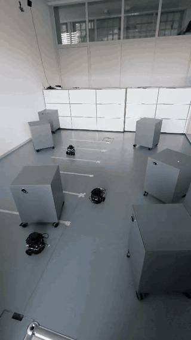
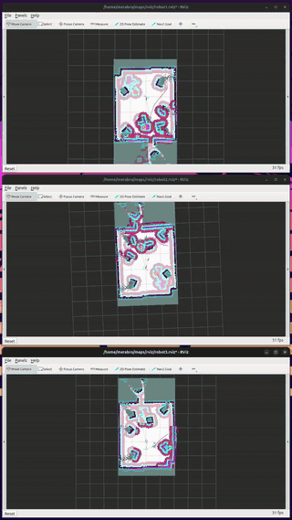

# Multi-robot SLAM and Nav2 on TurtleBot3

Launch scripts and configuration for decentralized multi-robot SLAM with one Nav2 navigation stack per robot on a fleet of TurtleBot3 Burger robots running ROS 2 Jazzy. Every robot builds a shared map from the localized scans of all robots. Every robot also treats the other robots as obstacles in its costmaps and its collision monitor. The setup was run with three robots.

| Robots | RViz, one window per robot |
|---|---|
|  |  |

The previews play at 1.5 times real speed. The full recordings are [media/real_robots.mp4](media/real_robots.mp4) (15 s) and [media/rviz_multi_slam.mp4](media/rviz_multi_slam.mp4) (28 s). Each RViz window shows the map and the global costmap of one robot, in which the other two robots appear as inflated discs.

## Relation to prior work

This repository does not implement SLAM, map merging or navigation. Mapping uses the decentralized multi-robot node of [slam_toolbox](https://github.com/SteveMacenski/slam_toolbox), which was added to the Rolling branch in pull request [#592](https://github.com/SteveMacenski/slam_toolbox/pull/592) (merged on 22 October 2025) and is not part of the Jazzy release. Navigation uses [Nav2](https://github.com/ros-navigation/navigation2). The robots run the ROBOTIS [TurtleBot3](https://github.com/ROBOTIS-GIT/turtlebot3) and [ld08_driver](https://github.com/ROBOTIS-GIT/ld08_driver) packages. The repository supplies the integration that real robots need: a relay that adapts the fleet TF tree and the lidar data to the conventions of the slam_toolbox node, a live pose source for mutual collision avoidance, namespaced Nav2 configuration and launch files. It also provides a Fast DDS profile that keeps three Nav2 stacks from saturating the wireless link.

## Requirements

- Laptop: Ubuntu 24.04 with ROS 2 Jazzy.
- Robots: TurtleBot3 Burger with a Raspberry Pi 4, an OpenCR board and an LDS-02 lidar, running ROS 2 Jazzy. Each robot has a workspace at `~/turtlebot3_ws` that contains `turtlebot3` and `ld08_driver`. Its `~/.bashrc` sources that workspace.
- Network: the laptop and the robots share one LAN with multicast enabled.

## Repository contents

| File | Purpose |
|---|---|
| `env.sh` | Laptop environment for every terminal: ROS 2, the slam_toolbox overlay, the ROS domain and a Fast DDS profile bound to the LAN address. |
| `multi_slam.sh` | Starts the relay and one slam_toolbox instance per robot. |
| `multi_nav2.sh` | Starts one namespaced Nav2 stack per robot. |
| `multi_rviz.sh` | Opens one RViz window per robot with the Nav2 panel. |
| `multi_robot_relay.py` | Relays each robot's TF into its namespace, resamples the lidar to 360 beams, publishes the start poses and publishes the live poses of all robots. |
| `launch/multi_nav2_launch.py` | Runs Nav2 `navigation_launch.py` inside a namespace with a 30 s lifecycle bond timeout. |
| `config/multi_slam_params.yaml` | slam_toolbox parameters, derived from its `mapper_params_online_multi_async.yaml`. |
| `config/nav2_multi_params.yaml` | Nav2 parameters for the Burger. `ROBOTNS` is replaced by the robot name at launch. |
| `config/multi_nav2_view.rviz` | RViz layout, derived from the Nav2 `nav2_namespaced_view.rviz`. |
| `robot/real_robot_bringup_launch.py` | Namespaced bringup that runs on each robot. |
| `media/` | Demonstration recordings. |

## Installation

### Laptop

```bash
sudo apt install ros-jazzy-navigation2 ros-jazzy-nav2-bringup ros-jazzy-turtlebot3-teleop
git clone https://github.com/prakash-aryan/turtlebot3-multi-robot-slam-nav2.git ~/turtlebot3-multi-robot-slam-nav2
mkdir -p ~/slam_toolbox_ws/src
cd ~/slam_toolbox_ws/src
git clone -b jazzy https://github.com/SteveMacenski/slam_toolbox.git
cd slam_toolbox
git fetch origin ros2
git cherry-pick -n 85f911662e
cd ~/slam_toolbox_ws
source /opt/ros/jazzy/setup.bash
rosdep install --from-paths src --ignore-src -y
colcon build --symlink-install --cmake-args -DCMAKE_BUILD_TYPE=Release
```

The cherry-pick applies the multi-robot commit from pull request #592 onto the Jazzy branch. After every boot of the laptop, enlarge the socket buffers:

```bash
sudo sysctl -w net.core.rmem_max=16777216 net.core.wmem_max=16777216
```

### Robots

Run on the laptop once per robot, with that robot's user name and address:

```bash
ssh <user>@<robot-ip> mkdir -p fleet
scp ~/turtlebot3-multi-robot-slam-nav2/robot/real_robot_bringup_launch.py <user>@<robot-ip>:fleet/
```

## Running

Place the robots before starting their bringup, because odometry starts at zero when bringup starts. The example below uses three robots in a line, all facing forward: robot2 in front at x = +0.5 m, robot1 in the middle at x = 0 and robot3 at the back at x = -0.5 m.

### Terminals 1 to 3: robots

Each robot gets its own terminal. Laptop:

```bash
ssh <user>@<robot1-ip>
```

Robot:

```bash
export ROBOT_NAME=robot1 ROS_DOMAIN_ID=31
ros2 launch ~/fleet/real_robot_bringup_launch.py
```

Repeat in terminal 2 with `ROBOT_NAME=robot2` and in terminal 3 with `ROBOT_NAME=robot3`.

### Terminal 4: laptop, relay and SLAM

```bash
source ~/turtlebot3-multi-robot-slam-nav2/env.sh
~/turtlebot3-multi-robot-slam-nav2/multi_slam.sh robot1:0:0:0 robot2:0.5:0:0 robot3:-0.5:0:0
```

Each argument is `name:x:y:yaw_degrees`. Logs are written to `/tmp/tb3_multi_robot`.

### Terminal 5: laptop, Nav2

Start this terminal about 15 s after terminal 4.

```bash
source ~/turtlebot3-multi-robot-slam-nav2/env.sh
~/turtlebot3-multi-robot-slam-nav2/multi_nav2.sh robot1 robot2 robot3
```

All three stacks are ready when this command prints 1 for each robot, which takes one to two minutes:

```bash
grep -c "Managed nodes are active" /tmp/tb3_multi_robot/nav2_robot*.log
```

### Terminal 6: laptop, RViz

```bash
source ~/turtlebot3-multi-robot-slam-nav2/env.sh
~/turtlebot3-multi-robot-slam-nav2/multi_rviz.sh robot1 robot2 robot3
```

The Nav2 Goal tool in a window sends a goal to that window's robot only.

### Terminal 7: laptop, goals and teleoperation

```bash
source ~/turtlebot3-multi-robot-slam-nav2/env.sh
ros2 action send_goal /robot1/navigate_to_pose nav2_msgs/action/NavigateToPose "{pose: {header: {frame_id: map}, pose: {position: {x: 1.0, y: 0.0}, orientation: {w: 1.0}}}}"
ros2 run turtlebot3_teleop teleop_keyboard --ros-args -r __ns:=/robot1
```

To cancel the goals of all robots:

```bash
for r in robot1 robot2 robot3; do ros2 service call /$r/navigate_to_pose/_action/cancel_goal action_msgs/srv/CancelGoal "{}"; done
```

## Adapting to another fleet

- Robot names: any names work, provided the same name is used for `ROBOT_NAME` on the robot and in the arguments of the three laptop scripts.
- Start poses: the poses passed to `multi_slam.sh` must match the real layout to within about 0.25 m and 20 degrees, because the slam_toolbox node only refines the initial alignment.
- ROS domain: set `TB3_DOMAIN_ID` before sourcing `env.sh` and use the same value for `ROS_DOMAIN_ID` on the robots. The default is 31.
- Network: set `TB3_LAN_IP` before sourcing `env.sh` if the laptop has more than one network interface.
- Fleet size: the scripts accept any number of robots. Each additional robot adds one slam_toolbox instance and one Nav2 stack on the laptop.

## Checks

```bash
source ~/turtlebot3-multi-robot-slam-nav2/env.sh
ros2 topic hz /robot1/odom
ros2 topic echo --once /fleet/poses
ros2 lifecycle get /robot1/bt_navigator
ros2 topic info /robot1/cmd_vel -v
```

The expected results are odometry at 18 to 20 Hz, one pose per robot in `/fleet/poses`, the state `active` and TwistStamped on both the publisher and the subscriber side of `cmd_vel`.

## Implementation notes

- The LDS-02 returns a different number of beams in every scan. slam_toolbox rejects scans whose length differs from the first one. The relay therefore resamples every scan to 360 beams and publishes it as `/robotN/scan_fixed`.
- The slam_toolbox node expects a per-robot TF tree on `/robotN/tf` with plain frame names and a shared `global_odom` frame. The fleet bringup publishes on the global `/tf` with `robotN/` prefixes. `turtlebot3_node` also prefixes the odometry frames twice. The relay strips the prefixes, publishes `odom` to `base_footprint` from `/robotN/odom` and publishes the start pose as `global_odom` to `odom`.
- In Jazzy, `navigation_launch.py` uses the namespace to rewrite the parameter file but does not push it onto the nodes. `launch/multi_nav2_launch.py` pushes the namespace and raises the lifecycle bond timeout, because the planner server needs more than the default 4 s to activate when three stacks start.
- `turtlebot3_node` subscribes to `Twist` unless `enable_stamped_cmd_vel` is set, while Nav2 publishes `TwistStamped`. The robot bringup sets the parameter.
- With three Nav2 stacks and the default Fast DDS transports, robot odometry dropped from 20 Hz to between 1 and 4 Hz. Restricting the laptop to its LAN address and enlarging the socket buffers restored about 18 Hz.
- The positions of the other robots come from their own SLAM estimates, so a disc can be offset by a few centimetres from the true robot. The inflation radius of 0.30 m covers this offset.

## License

Apache-2.0 (see `LICENSE`), except `config/multi_slam_params.yaml`, which is derived from slam_toolbox and remains under LGPL-2.1 (see `LICENSES/LGPL-2.1.txt`). `config/multi_nav2_view.rviz` is derived from `nav2_bringup`, which is licensed under Apache-2.0.
